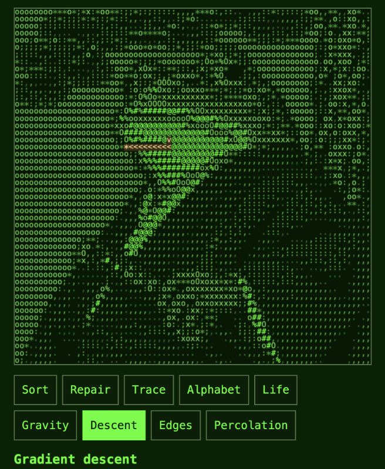
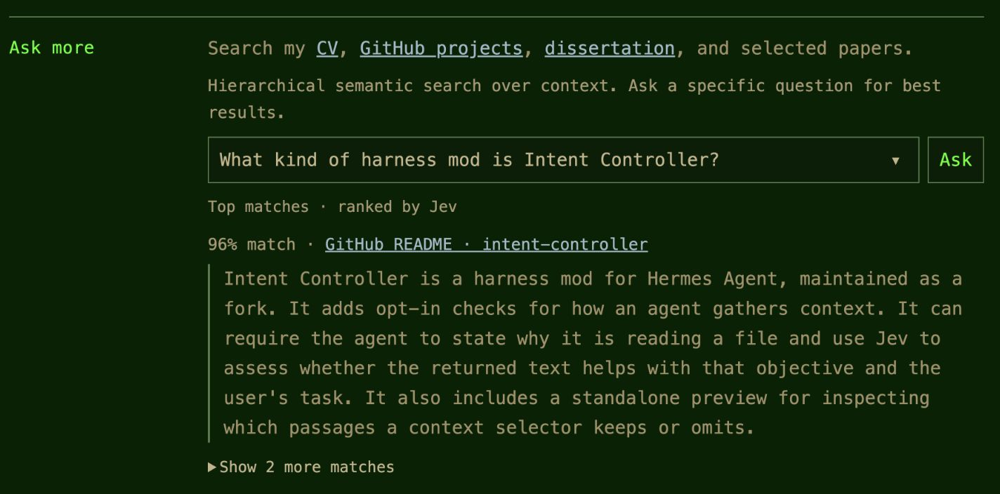
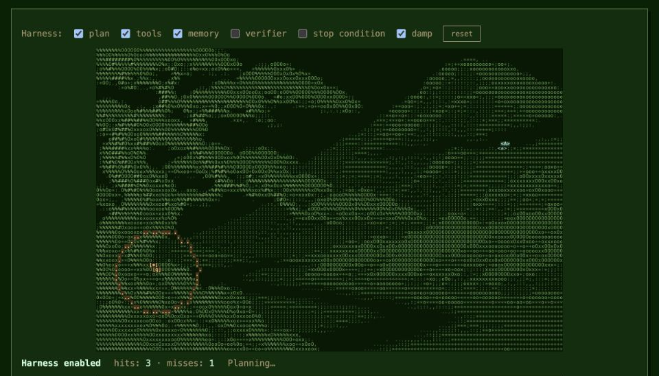

# Cameron Beebe’s portfolio

A portfolio for philosophy of science and agent engineering, with a CV, research, and interactive experiments. [Visit the site](https://cameronbeebe.github.io/) · CV ([Markdown](cv.md) or [PDF](Beebe_Resume_SciPhi.pdf))

## ASCII portrait

An interactive frog samurai rendered as a grid of characters. Sort or repair the portrait, change its glyph palette, or explore simulations such as gravity, gradient descent, and percolation. The screenshot shows a completed descent across the glyphs.

## Ask more

Search the CV, GitHub projects, dissertation, and selected papers. A Cloudflare Worker uses Jev to select sources and rank passages, then displays the excerpts with match scores and links to their sources.

## Agent = model + harness

Click the ASCII landscape to set a goal. Toggle planning, tools, memory, verification, stopping, and damping to see how the simulated agent’s movement and estimates change.

## Ashby’s regulator

A static demo of Ashby’s regulation game: a blind Pólya-urn regulator and a disturbance-conditioned one learn on the same payoff matrix, so the law of requisite variety is visible. The page at [`cybernetics/`](cybernetics/) is an identical mirror of the canonical source in [CameronBeebe/Cybernetics](https://github.com/CameronBeebe/Cybernetics) (`docs/`).

## Perplexity

An [interactive explainer](https://cameronbeebe.github.io/perplexity/) of language-model perplexity: its relationship to cross-entropy, log loss, bits per byte, and proper scoring rules, with measured token-level scores from GPT-2, DistilGPT-2, and SmolLM2-135M. The page lives at [`perplexity/`](perplexity/).

## Repository

- [`index.html`](index.html) contains the GitHub Pages site.
- [`cybernetics/`](cybernetics/) is an identical mirror of the Ashby regulator demo; the canonical source is [`docs/`](https://github.com/CameronBeebe/Cybernetics/tree/master/docs) in CameronBeebe/Cybernetics.
- [`perplexity/`](perplexity/) is the interactive perplexity explainer.
- [`assets/`](assets/) contains the artwork and browser code for the experiments and Ask panel.
- [`ask-worker/`](ask-worker/) contains the search backend and PDF indexer.
- The [portfolio Ask skill](.agents/skills/maintain-portfolio-ask/SKILL.md) explains how to test changes and maintain the deployed Worker.
