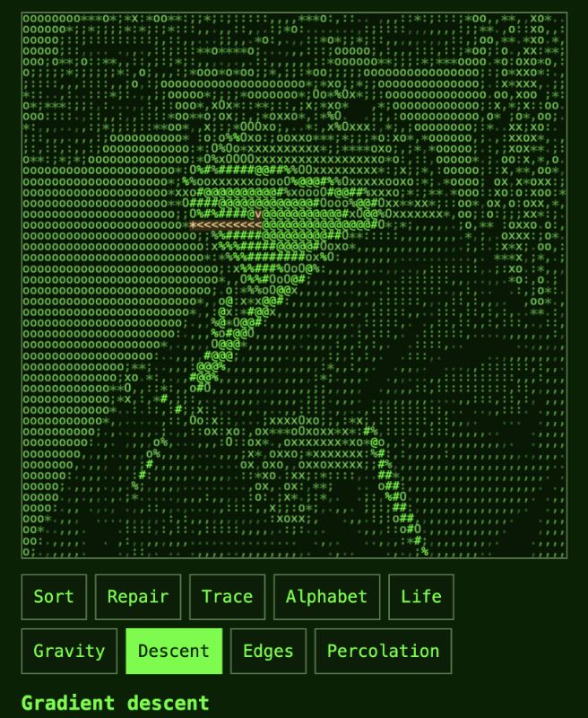
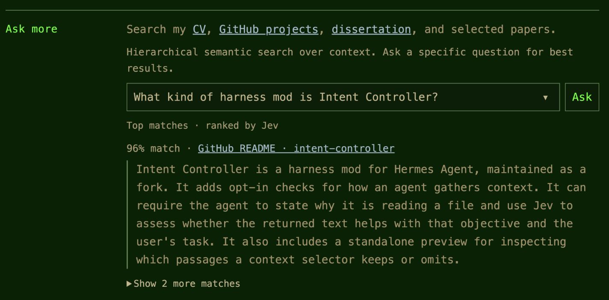
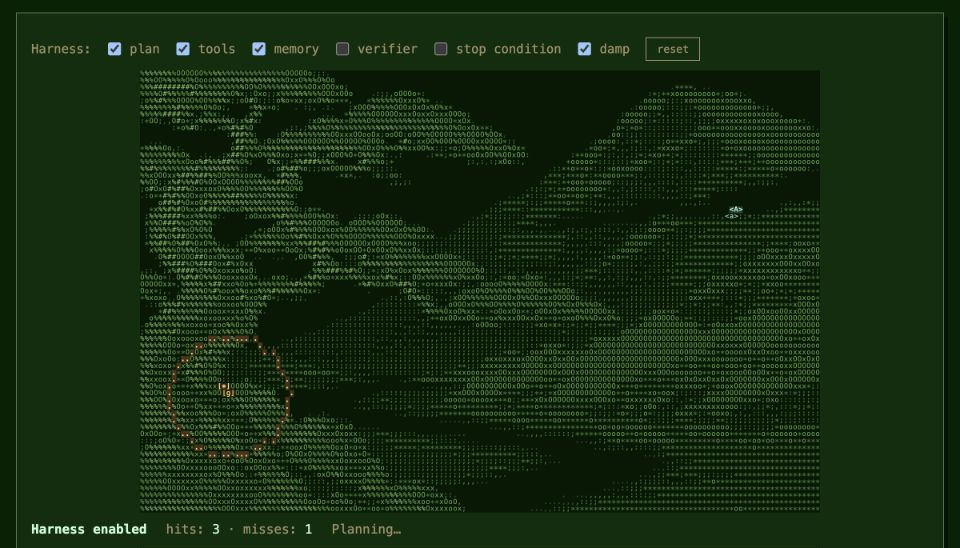

# Cameron Beebe’s portfolio

A portfolio for philosophy of science and agent engineering, with a CV, research, and interactive experiments. [Visit the site](https://cameronbeebe.github.io/) · CV ([Markdown](cv.md) or [PDF](Beebe_Resume_SciPhi.pdf))

## ASCII portrait

An interactive frog samurai rendered as a grid of characters. Sort or repair the portrait, change its glyph palette, or explore simulations such as gravity, gradient descent, and percolation. The screenshot shows a completed descent across the glyphs.

Fire turns visible glyph density into fuel: drag to ignite cells, watch heat spread and denser characters burn longer, then rewind the burn with Restore.

Color lets visitors describe a mood and compare palettes from three inexpensive OpenRouter models. Each result previews the current glyph grid and reports response timing, validation, and usage cost. Selecting a palette progressively recolors the cells; Restore rewinds those edits.

## Ask more

Search the CV, GitHub projects, dissertation, and selected papers. A Cloudflare Worker uses Jev to select sources and rank passages, then displays the excerpts with match scores and links to their sources.

## Agent = model + harness

Click the ASCII landscape to set a goal. Toggle planning, tools, memory, verification, stopping, and damping to see how the simulated agent’s movement and estimates change.

## Repository

- [`index.html`](index.html) contains the GitHub Pages site.
- [`assets/`](assets/) contains the artwork and browser code for the experiments and Ask panel.
- [`ask-worker/`](ask-worker/) contains the search backend and PDF indexer.
- The [portfolio Ask skill](.agents/skills/maintain-portfolio-ask/SKILL.md) explains how to test changes and maintain the deployed Worker.
